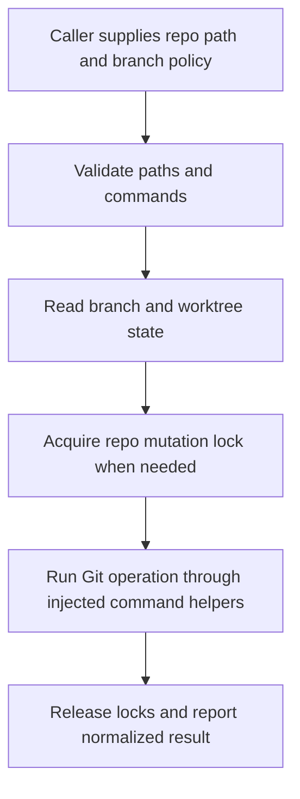

# @gg-utils/worktree-core

Product-neutral Git worktree, branch, repo-lock, foundation, and shell-shim primitives.

This package is the low-level worktree stack. It owns branch-prefix parsing, safe subprocess and
filesystem helpers, Git branch/worktree probes, repo mutation locks, worktree discovery, and a small
shell-facing argument parser. Project-specific slot policies, realm naming, local-edge integration,
env materialization hooks, and UI flows belong in `@gg-utils/worktree-kit` or in consuming adapters.

## Install

```bash
npm install @gg-utils/worktree-core@git+https://github.com/gg-utils/worktree-core.git#main
```

Pinned dependency example:

```json
{
  "dependencies": {
    "@gg-utils/worktree-core": "git+https://github.com/gg-utils/worktree-core.git#88aa102"
  }
}
```

## When To Use

- You need product-neutral helpers around Git branches and Git worktrees.
- You need filesystem/repo lock helpers for mutation-safe orchestration.
- You need prepared-worktree discovery helpers without pulling in UI packages.
- You need a small shell shim for worktree discovery scripts.

## Public Surfaces

| Import | Purpose |
|---|---|
| `@gg-utils/worktree-core/prefix` | Branch-prefix constants and parsing. |
| `@gg-utils/worktree-core/foundation` | Logging, command execution, guards, quoting, JSON, timing. |
| `@gg-utils/worktree-core/git-branches` | Remote/branch probes, checkout, and upstream helpers. |
| `@gg-utils/worktree-core/git-worktree-sync` | Worktree registration and checkout attachment helpers. |
| `@gg-utils/worktree-core/repo-locks` | Filesystem mutex and repo mutation locks. |
| `@gg-utils/worktree-core/worktree-discovery` | Prepared-worktree metadata and slot discovery. |
| `@gg-utils/worktree-core/shell-shim` | Shell-facing argv parsing and dispatch contracts. |

## Quick Start

```ts
import {
  WORKTREE_STACK_DEFAULT_BRANCH_PREFIX,
  worktreeStackInfo,
} from "@gg-utils/worktree-core";

worktreeStackInfo(
  `Default branch prefix: ${WORKTREE_STACK_DEFAULT_BRANCH_PREFIX}`,
);
```

## Operational Flow



## Development

```bash
git clone https://github.com/gg-utils/worktree-core.git
cd worktree-core
npm run type-check
npm test
npm run build
```

Scripts currently expect the source-first workspace toolchain.

## Layout

```text
.
|-- src/prefix.ts
|-- src/foundation.ts
|-- src/git-branches.ts
|-- src/git-worktree-sync.ts
|-- src/repo-locks.ts
|-- src/worktree-discovery.ts
|-- src/shell-shim.ts
|-- dist/
`-- package.json
```

## Caveats

- Helpers can invoke Git through injected command runners; callers choose when to mutate repos.
- This package intentionally has no UI, no local-edge policy, and no environment materialization.
- Prefer `@gg-utils/worktree-kit` for full command and UI workflows.

## Use from another repository

Requires Node `>=22.0.0 <27`. Install the built JavaScript and declarations by tag:

```json
{"dependencies": {"@gg-utils/worktree-core": "git+https://github.com/gg-utils/worktree-core.git#v0.2.0"}}
```
